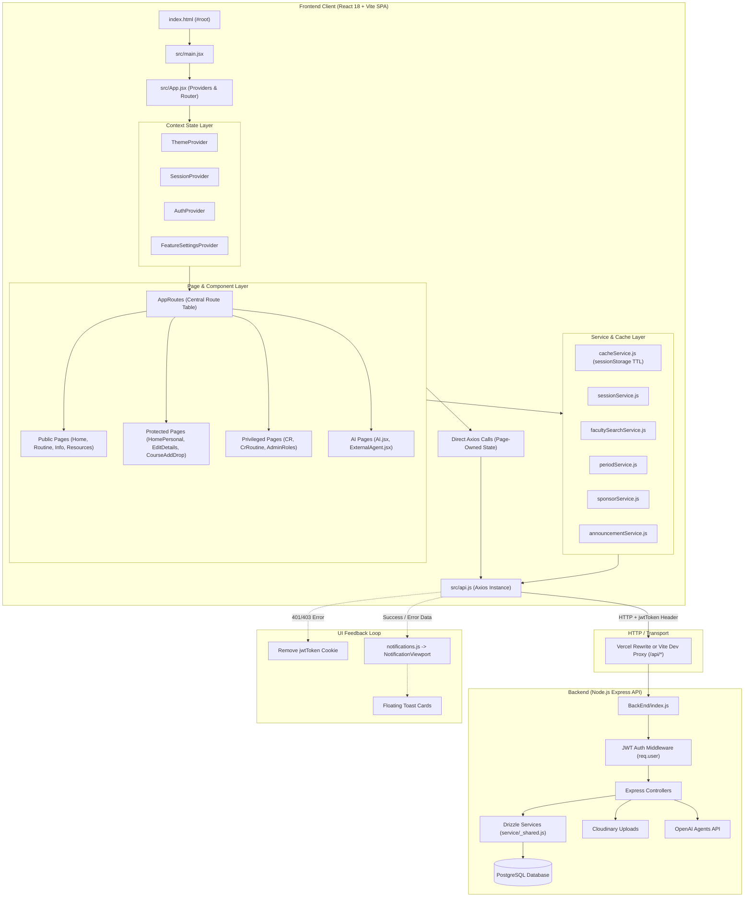

# Frontend Architecture Guide: RMS (Routine Management System)

> [!IMPORTANT]
> **Mandatory Agent Instruction:**
> Any coding agent working on this repository **must read and follow this architecture skill before making meaningful changes to the frontend**.
> This document describes the **actual implementation that exists in the repository**, not an idealized architecture. Always inspect relevant source files before modifying them, as implementation details may evolve over time.
> Whenever a frontend change materially affects the architecture, file map, feature map, data flow, or shared conventions, update the relevant section of this skill as part of your task.

---

## A. Project Overview and Technology Stack

### Application Purpose and Core Capabilities
**RMS (Routine Management System)** is an academic management and resource-sharing platform engineered primarily for students, faculty, Class Representatives (CRs), and administrators at International Islamic University Chittagong (IIUC). 

Its main user-facing capabilities include:
1. **Academic Routine Lookup & Management**: Comprehensive schedule viewing across sections (`/routine/section`), teachers (`/routine/teacher`), classrooms (`/classroom/routine`), and authenticated personal timetables (`/routine/personalroutine`, `/homepersonal`).
2. **Personal Timetable & Course Registration**: Student dashboard (`/homepersonal`) with credit metrics, upcoming class countdown, personal course add/drop workflows (`/courseadddrop`), and completed course lists (`/showall`).
3. **Class Representative (CR) Management**: Specialized CR portal (`/CR`, `/CR/routine`) to build, adjust, and maintain section class schedules, room allocations, time slots, and teacher assignments.
4. **Administrative Console**: Full administrative portal (`/admin/users`) for user role administration (Admin, CR, Student), academic session management, routine period schedule configuration, sponsored announcements, partner sponsors, AI query audit logs, and student submission review (e.g., password change requests, complaints, suggestions).
5. **Academic Resource Repository**: Crowdsourced study materials and lecture notes (`/resources`, `/info/materials`) with search, keyword tags, multi-criteria sorting (newest, top-rated), community star ratings, and upload contribution stats (`/edit/details?tab=resources`).
6. **Campus & Academic Directory**: Student community search directory (`/info/community`), faculty information lookup (`/info/teacher`), course catalog (`/info/course`), section directory (`/info/section`), campus shuttle bus schedules (`/info/bus`), and open-source contributor credits (`/info/contributor`).
7. **AI Academic Assistant & Agent Pipelines**: Gated AI assistant (`/ai`) backed by OpenAI agents for answering student academic queries, plus external agent tools for extracting teacher CVs and PDF documents (`/externalagent`, `/externalagent/teacherinfoextract`).

---

### Verified Technology Stack

| Layer / Concern | Technology | Version | Location / Source | Implementation Details |
| :--- | :--- | :--- | :--- | :--- |
| **Framework & Runtime** | React | `^18.3.1` | `package.json`, `src/` | Functional components, hooks, React Context, `React.lazy` code splitting. |
| **DOM Renderer** | React DOM | `^18.3.1` | `src/main.jsx` | Mounts root component `<App />` into `#root`. |
| **Build Tool & Dev Server** | Vite | `^6.0.1` | `vite.config.js` | Fast HMR dev server and Rollup-based production bundling. |
| **Vite React Plugin** | `@vitejs/plugin-react` | `^4.3.4` | `vite.config.js` | Babel-based React Fast Refresh and JSX transformation. |
| **Routing** | React Router DOM | `^7.0.2` | `src/App.jsx` | `BrowserRouter`, `Routes`, `Route`, `Navigate`, `useNavigate`, `useSearchParams`, `NavLink`. |
| **HTTP Client** | Axios | `^1.7.9` | `src/api.js` | Single Axios instance with base URL resolution and custom auth request/response interceptors. |
| **Cookie Management** | js-cookie | `^3.0.5` | `src/api.js`, auth pages | Client-side cookie storage for `jwtToken` (7-day default persistence). |
| **Styling & CSS** | Tailwind CSS | `^3.4.16` | `tailwind.config.js`, `src/index.css` | Utility-first CSS, class-based dark mode (`darkMode: "class"`), design tokens in CSS variables. |
| **CSS Post-processing** | PostCSS + Autoprefixer | `^8.4.49` / `^10.4.20` | `postcss.config.js` | PostCSS build pipeline for Tailwind and vendor prefixing. |
| **Iconography** | React Icons (Feather) | `^5.4.0` | `src/**/*.jsx` | Accessible SVG vector icons imported primarily from `react-icons/fi`. |
| **Linting & Code Quality** | ESLint | `^9.15.0` | `eslint.config.js` | Modern flat config with React, React Hooks, and React Refresh rules. |
| **Hosting & Proxy** | Vercel SPA Config | - | `vercel.json` | Relative `/api/*` rewrite to backend and `/(.*)` catch-all rewrite to `/index.html`. |

---

### Clarifications on Absent Technologies (Explicitly Verified)
To avoid false assumptions by future coding agents:
- **No TypeScript**: The frontend is written exclusively in JavaScript/JSX (`.js`, `.jsx`). There are no `tsconfig.json` or `.ts`/`.tsx` source files in `FrontEnd/src/`.
- **No Redux / Zustand / React Query / SWR**: State management is intentionally lightweight, utilizing React Context at the application root and localized `useState`/`useEffect` hooks within pages.
- **No Form or Schema Validation Libraries**: Formik, React Hook Form, Yup, and Zod are **not** installed in `FrontEnd/package.json`. Forms use controlled component state (`useState`) with manual programmatic validation.
- **No shadcn/ui or Radix UI**: shadcn/ui CLI and Radix primitives are **not** present. Reusable UI components are custom built with Tailwind CSS in `src/pages/components/ui.jsx`.
- **No Framer Motion**: Framer Motion is **not** installed. UI animations rely on pure CSS keyframe classes declared in `src/index.css` (`animate-enter`, `animate-soft-pulse`, `animate-marquee`).
- **No Supabase & No WebSockets**: Supabase client libraries (`@supabase/supabase-js`) and WebSocket/Socket.io libraries are **not** used. Backend database interactions occur via an Express REST API backed by Drizzle ORM and PostgreSQL.
- **No Peer-to-Peer Chat / Realtime Messaging**: The application does **not** feature real-time direct messaging, group conversations, or chat sidebars.

---

### Theme Management
Theme switching supports **Light** and **Dark** modes:
- **Provider**: `ThemeProvider` in `src/App.jsx`.
- **Persistence**: Persisted in `localStorage.getItem("theme")` with fallback to `window.matchMedia("(prefers-color-scheme: dark)")`.
- **DOM Class**: Directly toggles the `.dark` class on `document.documentElement` (`<html>`).
- **CSS Tokens**: Controlled via CSS custom properties in `src/index.css` under `:root` and `.dark` (`--page-bg`, `--page-fg`, `--panel-bg`, `--panel-border`, `--brand`, `--accent`, `--shadow-color`).
- **Control**: Exposed via `useTheme()` hook (`theme`, `toggleTheme()`) and toggled by Sun/Moon icon buttons in `src/pages/components/Header.jsx`.

---

### Important Development Scripts

```bash
# Install dependencies
npm install

# Start Vite local development server (runs on http://localhost:5173 by default)
npm run dev
# (On Windows PowerShell where npm script execution is restricted, run: npm.cmd run dev)

# Build optimized production bundle to dist/
npm run build
# (or: npm.cmd run build)

# Execute ESLint verification across all source files
npm run lint
# (or: npm.cmd run lint)

# Preview production build locally
npm run preview
# (or: npm.cmd run preview)
```

---

## B. Repository and Frontend File Structure

```text
FrontEnd/
├── index.html                   # Vite HTML shell exposing <div id="root"></div>
├── package.json                 # Scripts, dependencies, devDependencies
├── package-lock.json            # Deterministic dependency lockfile
├── vite.config.js               # Vite bundler configuration with @vitejs/plugin-react
├── tailwind.config.js           # Tailwind CSS configuration (darkMode: "class")
├── postcss.config.js            # PostCSS plugin pipeline (tailwindcss, autoprefixer)
├── vercel.json                  # Production API rewrites and SPA history fallback
├── eslint.config.js             # ESLint 9 flat configuration
├── .env                         # Environment variables (VITE_URL)
├── .gitignore                   # Ignored files (node_modules, dist, etc.)
├── ARCHITECTURE.md              # Authoritative frontend architectural documentation
├── README.md                    # Project overview and run instructions
├── public/
│   └── rms-icon.svg             # Application favicon / brand vector
└── src/
    ├── main.jsx                 # Application entry point; mounts <App />
    ├── App.jsx                  # Root component, Context Providers, Route Table, App Frame
    ├── api.js                   # Configured Axios client with JWT interceptors
    ├── index.css                # Tailwind layers, CSS design tokens, reusable component classes
    ├── assets/
    │   ├── iiuc.webp            # Bundled campus hero and backdrop image (375 KB)
    │   └── react.svg            # React asset
    ├── services/                # Specialized API wrappers, caching, and domain logic
    │   ├── adminService.js          # Admin AI query log fetching
    │   ├── announcementService.js  # Announcements fetching, creation, visibility toggles
    │   ├── cacheService.js         # TTL sessionStorage caching with prefix invalidation
    │   ├── facultySearchService.js # Faculty search, suggestions, and query resolution
    │   ├── periodService.js        # Schedule slots, shift mappings, usePeriods() hook
    │   ├── routineDetails.js       # Comma-delimited routine data parsing and formatting
    │   ├── sessionService.js       # Academic session listing, creation, and updating
    │   ├── settingsService.js      # Global AI feature setting retrieval and patching
    │   └── sponsorService.js       # Sponsor data normalization, logo upload, social links
    └── pages/
        ├── home.jsx             # Public landing page and section routine lookup
        ├── SectionRoutine.jsx   # Dedicated section routine search and viewing
        ├── Resources.jsx        # Public course study material discovery page
        ├── AI.jsx               # Gated AI academic assistant interface
        ├── ExternalAgent.jsx    # PDF parsing and agent-assisted extraction
        ├── TeacherInfoExtract.jsx # Teacher data extraction helper
        ├── admin/
        │   └── AdminRoles.jsx   # Multi-tab admin control center (roles, sessions, periods, logs)
        ├── authentication/
        │   ├── Login.jsx        # Login form and student password reset submission flow
        │   ├── Logout.jsx       # Standalone logout confirmation view
        │   └── RegistrationForm.jsx # New student account registration form
        ├── personal/
        │   ├── HomePersonal.jsx    # Primary student dashboard with timetable and stats
        │   ├── LoggedHome.jsx      # Class schedule entry screen for CRs/contributors
        │   ├── EditDetails.jsx     # Profile editing, avatar upload, password change, stats
        │   ├── PersonalRoutine.jsx # Personal routine viewer by academic session
        │   ├── CourseAddDrop.jsx   # Interactive course add/drop timetable search
        │   └── ShowAllCourse.jsx   # Completed and registered courses overview
        ├── CR/
        │   ├── CR.jsx              # CR overview dashboard and section quick links
        │   └── CrRoutine.jsx       # Interactive routine grid and slot editor for CRs
        ├── info/
        │   ├── TeacherInfo.jsx     # Teacher contact and designation directory
        │   ├── CourseInfo.jsx      # Course syllabus and credit information
        │   ├── SectionInfo.jsx     # Section listings and capacities
        │   ├── Community.jsx       # Student community directory and peer search
        │   ├── Contributor.jsx     # Project contributors acknowledgement
        │   ├── StudyMaterials.jsx  # Semester-wise course resources (Semester component)
        │   └── BusSchedule.jsx     # Campus shuttle bus timings and routes
        ├── room/
        │   ├── ClassroomRoutine.jsx # Room schedule lookup by day and slot
        │   └── RoomAvailability.jsx# Room availability checker
        ├── teacher/
        │   └── Fullroutine.jsx     # Complete teacher routine timetable lookup
        └── components/
            ├── Header.jsx          # Responsive app header with role-based navigation
            ├── GlobalFooter.jsx    # Site footer with quick links and feedback trigger
            ├── ui.jsx              # Shared visual primitives (PageShell, SectionHeading, etc.)
            ├── notifications.js    # In-memory pub/sub notification emitter
            ├── RoutineTable.jsx    # Reusable timetable matrix component
            ├── RoutineDetailsModal.jsx # Detailed class info modal with quick lookups
            ├── RoutineActionToggle.jsx # Action bar toggle for routine modifications
            ├── ResourceBrowser.jsx # Searchable, sortable, rateable resource list
            ├── ResourceHighlights.jsx # Dashboard compact highlights of top resources
            ├── ProfileResourceStats.jsx # Student resource contribution stats card
            ├── profileResourceStatsUtils.js # Resource statistics normalization helpers
            ├── SponsorDisplay.jsx  # Sponsor banners, logos, and social link renderer
            ├── MarkdownRenderer.jsx# Custom Markdown parser and renderer for AI answers
            └── Nav1.jsx            # Legacy navigation stub
```

---

## C. File Map

| File Path | Primary Responsibility | When to Modify | Consumers / Relationships |
| :--- | :--- | :--- | :--- |
| **`src/main.jsx`** | Bootstraps React into DOM root `#root`. | Only when changing root hydration or bootstrapping. | Browser entry point. |
| **`src/App.jsx`** | Central route table, lazy imports, Context Providers (`ThemeProvider`, `SessionProvider`, `AuthProvider`, `FeatureSettingsProvider`), fallback shells. | Adding/removing routes, global contexts, or app-level error handling. | Root application, all pages. |
| **`src/api.js`** | Configures Axios instance, `jwtToken` request header interceptor, and 401/403 cookie cleanup. | Altering API base URLs, custom headers, or response interceptor policies. | All services and data-fetching pages. |
| **`src/index.css`** | Defines CSS custom properties (tokens), base typography, and reusable Tailwind `@layer components` classes (`.surface-card`, `.btn-primary`, `.form-field`, etc.). | Changing design tokens, button styles, card borders, or global animations. | All pages and components. |
| **`src/services/sessionService.js`** | API helpers for active academic session (`GET /api/session/active`), session listing, creation, and updating. | Modifying session endpoints or payload contracts. | `App.jsx`, `AdminRoles.jsx`, routine pages. |
| **`src/services/settingsService.js`** | Fetches and patches global AI feature flag (`GET /api/settings/ai`, `PATCH /api/admin/settings/ai`). | Changing AI toggle contracts or backend setting endpoints. | `App.jsx`, `AdminRoles.jsx`, `Header.jsx`. |
| **`src/services/sponsorService.js`** | Normalizes and manages sponsor banners, logo uploads, and social links (`/api/sponsors/*`, `/api/admin/sponsor`). | Updating sponsor schemas, endpoints, or social link formats. | `AdminRoles.jsx`, `SponsorDisplay.jsx`, `home.jsx`. |
| **`src/services/announcementService.js`** | Manages featured announcements, image uploads, and visibility toggles (`/api/announcements/*`, `/api/admin/announcement*`). | Modifying announcement fields or endpoint paths. | `AdminRoles.jsx`, `home.jsx`. |
| **`src/services/facultySearchService.js`** | Auto-suggests and searches faculty members by name/code with pagination (`/api/lookLike/facultyAnyLookLike/*`, `/api/teacher/search-any/*`). | Changing teacher autocomplete or search logic. | `CR.jsx`, `home.jsx`, `CourseAddDrop.jsx`. |
| **`src/services/periodService.js`** | Defines time slots, male/female shift schedules, fallback periods, and provides `usePeriods()` hook. | Altering routine period timings, shift rules, or period endpoints (`/api/period`). | `RoutineTable.jsx`, `PersonalRoutine.jsx`, `AdminRoles.jsx`. |
| **`src/services/routineDetails.js`** | Splits comma-delimited class records into structured detail objects (`courseCode`, `faculty`, `room`, `slot`). | Modifying routine string parsing or multi-teacher formatting. | `RoutineTable.jsx`, `RoutineDetailsModal.jsx`, `home.jsx`. |
| **`src/services/adminService.js`** | Fetches latest AI query audit logs (`GET /api/admin/ai-query-logs`). | Changing admin log query options or response shaping. | `AdminRoles.jsx`. |
| **`src/services/cacheService.js`** | Provides opt-in `sessionStorage` caching (`cachedRequest`) with TTL (60s default) and prefix invalidation (`clearCacheByPrefix`). | Tuning client-side caching TTLs or cache key policies. | `home.jsx`, `HomePersonal.jsx`, `CourseAddDrop.jsx`. |
| **`src/pages/components/ui.jsx`** | Core UI component catalog: `PageShell`, `SectionHeading`, `FormField`, `SuggestionList`, `MetricCard`, `LoadingState`, `EmptyState`, `NotificationViewport`, `Notice`, `cx()`. | Adjusting reusable design primitives, form field wrappers, or notification rendering. | Used across almost all pages. |
| **`src/pages/components/notifications.js`** | In-memory pub/sub notification emitter with auto-dismissal and deduplication. | Changing toast notification lifetimes, sound, or dispatch logic. | `ui.jsx`, `CourseAddDrop.jsx`, various pages. |
| **`src/pages/components/Header.jsx`** | Sticky navigation bar; derives role privileges (`isAdmin`, `isCrOrAdmin`), renders mobile drawer, theme toggler, and profile menu. | Adding navigation links, changing role visibility, or adjusting mobile menu. | Rendered at the top of pages or via layout. |
| **`src/pages/components/GlobalFooter.jsx`** | Global application footer with links, copyright, and user feedback trigger. | Changing footer navigation links or contact information. | Rendered in `AppFrame` in `App.jsx`. |
| **`src/pages/components/RoutineTable.jsx`** | Unified timetable matrix displaying days vs. period time slots with cell click hooks. | Modifying grid layout, timetable cell rendering, or print styles. | `home.jsx`, `HomePersonal.jsx`, `PersonalRoutine.jsx`, `SectionRoutine.jsx`. |
| **`src/pages/components/RoutineDetailsModal.jsx`** | Modal popup displaying full class metadata, teacher info, and related study resources. | Adding class metadata fields or deep links to course info. | `HomePersonal.jsx`, `RoutineTable.jsx`. |
| **`src/pages/components/ResourceBrowser.jsx`** | Searchable grid/table of course resources with star rating submission and filtering. | Modifying resource cards, search parameters, or rating interactions. | `Resources.jsx`, `EditDetails.jsx`, `Community.jsx`. |
| **`src/pages/components/ResourceHighlights.jsx`** | Carousel/card highlight of recent and top-rated academic resources. | Changing dashboard resource preview cards or sorting. | `home.jsx`, `HomePersonal.jsx`. |
| **`src/pages/components/ProfileResourceStats.jsx`** | Visual summary card displaying a student's uploaded resources and average rating received. | Changing user reputation or contribution metrics. | `EditDetails.jsx`, `Community.jsx`. |
| **`src/pages/components/SponsorDisplay.jsx`** | Renders partner sponsor banners, logo badges, and social media links. | Updating sponsor card presentation or social link icons. | `home.jsx`, `AdminRoles.jsx`. |
| **`src/pages/components/MarkdownRenderer.jsx`** | Custom lightweight Markdown parser for AI responses (headings, code blocks, lists, links). | Updating Markdown token styling or code syntax formatting. | `AI.jsx`. |
| **`src/pages/home.jsx`** | Public landing page, section routine search, top contributors, announcements, and sponsor showcases. | Modifying hero banner, landing statistics, or public search layout. | Public entrance (`/`). |
| **`src/pages/authentication/Login.jsx`** | User login form (`/api/login`) and student password change request submission flow. | Modifying credentials form, login validation, or reset requests. | Route `/auth/login`. |
| **`src/pages/authentication/RegistrationForm.jsx`** | Student registration form (`/api/register/new`) with ID, section, gender, and password. | Changing registration input fields or initial validation. | Route `/auth/reg`. |
| **`src/pages/authentication/Logout.jsx`** | Dedicated logout confirmation screen for legacy links. | Modifying sign-out redirect destination or messaging. | Route `/auth/logout`. |
| **`src/pages/personal/HomePersonal.jsx`** | Main authenticated student dashboard; displays current class, daily schedule, and credit stats. | Changing dashboard widgets, current-class indicators, or timetable views. | Route `/homepersonal`. |
| **`src/pages/personal/LoggedHome.jsx`** | Class schedule entry screen for authorized contributors/CRs (`POST /api/routine/add`). | Updating quick class-entry forms or slot selectors. | Route `/home`. |
| **`src/pages/personal/EditDetails.jsx`** | Profile management tabs: personal info, avatar upload (`FormData` with `profilePic`), password change, my resources. | Modifying student profile fields, avatar upload endpoints, or password policies. | Route `/edit/details`. |
| **`src/pages/personal/CourseAddDrop.jsx`** | Interactive search and course add/drop management interface. | Modifying course search filters, add/drop API calls, or credit limits. | Route `/courseadddrop`. |
| **`src/pages/personal/PersonalRoutine.jsx`** | Session-filtered personal routine view with period time slots and print/export options. | Modifying personal routine views or export options. | Route `/routine/personalroutine`. |
| **`src/pages/personal/ShowAllCourse.jsx`** | Lists all courses associated with the student's program and enrollment status. | Updating course history views or prerequisite displays. | Route `/showall`. |
| **`src/pages/admin/AdminRoles.jsx`** | Administrative console: role assignment, user search, sessions, period timings, announcements, AI logs, submissions. | Modifying administrative features, user permissions, or submission review. | Route `/admin/users`. |
| **`src/pages/CR/CR.jsx`** | Class Representative management overview: faculty additions, class search, section stats. | Modifying CR tools or section management shortcuts. | Route `/CR`. |
| **`src/pages/CR/CrRoutine.jsx`** | Interactive routine editor grid allowing CRs to assign teachers, rooms, and slots to section routines. | Modifying routine cell editing, conflict detection, or CR mutations. | Route `/CR/routine`. |
| **`src/pages/info/Community.jsx`** | Student community directory with name/ID search, section filters, gender filters, and profile modals. | Updating student search filters, pagination, or directory cards. | Route `/info/community`. |
| **`src/pages/AI.jsx`** | Gated single-turn AI academic chat assistant backed by OpenAI backend agents. | Modifying AI prompt input, suggested prompts, or streaming behavior. | Route `/ai`. |
| **`src/pages/ExternalAgent.jsx`** | Multi-step agent document extraction tool for parsing resumes, PDFs, and teacher schedules. | Updating document upload pipelines or parsing result displays. | Route `/externalagent`. |
| **`src/pages/TeacherInfoExtract.jsx`** | Document-based teacher information extraction utility. | Changing teacher data extraction interfaces. | Route `/externalagent/teacherinfoextract`. |

---

## D. Feature Map

### 1. Authentication & Session Management
- **User-Facing Purpose**: Allows students, CRs, and admins to sign in securely, access protected dashboards, submit password change requests, or register new accounts.
- **Main Pages & Components**: `src/pages/authentication/Login.jsx`, `src/pages/authentication/RegistrationForm.jsx`, `src/pages/authentication/Logout.jsx`, `src/App.jsx` (`AuthProvider`).
- **Hooks & State**: `useAuth()` (`isLoggedIn`, `user`, `refreshLoginStatus`, `loadingAuth`), `Cookies.get("jwtToken")`.
- **Backend Endpoints**: `POST /api/login`, `POST /api/register/new`, `GET /api/user/profile`, `POST /api/submissions/password-change`.
- **Authorization Requirements**: Publicly accessible; logged-in users navigating to `/auth/login` or `/auth/reg` are automatically redirected to `/homepersonal`.
- **Realtime Behavior**: None. Synchronous HTTP request/response.
- **Affected Dependencies**: `src/api.js` (intercepts requests with `jwtToken` header; removes cookie on 401/403).

### 2. Routine Lookup (Public & Personal)
- **User-Facing Purpose**: Enables anyone to view class routines by section, teacher, or classroom; lets logged-in students view their customized personal schedule.
- **Main Pages & Components**: `src/pages/home.jsx`, `src/pages/SectionRoutine.jsx`, `src/pages/teacher/Fullroutine.jsx`, `src/pages/room/ClassroomRoutine.jsx`, `src/pages/personal/PersonalRoutine.jsx`, `src/pages/personal/HomePersonal.jsx`, `src/pages/components/RoutineTable.jsx`, `src/pages/components/RoutineDetailsModal.jsx`.
- **Hooks & State**: `useActiveSession()`, `usePeriods()`, `cachedRequest()` via `cacheService.js`.
- **Backend Endpoints**: `GET /api/routine/section/:section/:session`, `GET /api/routine/teacher/:faculty/:session`, `GET /api/routine/classroom/:room/:session`, `GET /api/routine/personalroutine/:session`, `GET /api/period`, `GET /api/session/active`.
- **Authorization Requirements**: Section, teacher, and room routines are public. Personal routines require `isLoggedIn === true`.
- **Realtime Behavior**: None. Routines are cached client-side in `sessionStorage` with a 60–120s TTL to prevent duplicate requests.

### 3. Student Community & User Search
- **User-Facing Purpose**: Discover fellow students, view peer profiles, inspect their section/batch, and browse their uploaded study resources.
- **Main Pages & Components**: `src/pages/info/Community.jsx`, `src/pages/components/ResourceBrowser.jsx`, `src/pages/components/ProfileResourceStats.jsx`.
- **Hooks & State**: `useSearchParams()` for query persistence (`?search=`, `?page=`, `?section=`, `?gender=`).
- **Backend Endpoints**: `GET /api/community/students` (supports pagination, search query, gender filter, section filter).
- **Authorization Requirements**: Publicly viewable directory.
- **Realtime Behavior**: None. Debounced input triggering HTTP fetch with pagination.

### 4. Course Add/Drop & Timetable Customization
- **User-Facing Purpose**: Students can search for course sections and add or drop individual classes to construct their personal schedule.
- **Main Pages & Components**: `src/pages/personal/CourseAddDrop.jsx`, `src/pages/personal/ShowAllCourse.jsx`.
- **Hooks & State**: Local `rowState`, `useActiveSession()`, `notify()` for toast messages, `clearCacheByPrefix("personal_routine")`.
- **Backend Endpoints**: `GET /api/courses/search`, `POST /api/routine/personal/add`, `DELETE /api/routine/personal/drop`.
- **Authorization Requirements**: Authenticated student only (`isLoggedIn === true`).
- **Realtime Behavior**: None. Mutations immediately invalidate cached personal routines and update local row status.

### 5. Class Representative (CR) Routine Editor
- **User-Facing Purpose**: Empower elected CRs to assign rooms, faculties, days, and time slots to their section's academic schedule.
- **Main Pages & Components**: `src/pages/CR/CR.jsx`, `src/pages/CR/CrRoutine.jsx`, `src/pages/personal/LoggedHome.jsx`.
- **Hooks & State**: Local grid state, faculty suggestion state (`fetchFacultySuggestions`).
- **Backend Endpoints**: `GET /api/cr/routine/:section`, `POST /api/routine/update`, `POST /api/routine/add`, `DELETE /api/routine/delete`.
- **Authorization Requirements**: Authenticated user with role `cr` or `admin` (`useAuth().user.type`). Server middleware enforces CR authorization.
- **Realtime Behavior**: None. Changes take effect upon form/cell submission.

### 6. Academic Resource Repository & Ratings
- **User-Facing Purpose**: Upload, browse, search, and rate academic study links, PDF slides, and past papers.
- **Main Pages & Components**: `src/pages/Resources.jsx`, `src/pages/components/ResourceBrowser.jsx`, `src/pages/components/ResourceHighlights.jsx`, `src/pages/personal/EditDetails.jsx` (Resources tab).
- **Hooks & State**: Local filter state (course keywords, sorting by `newest` or `rating`), rating modal state.
- **Backend Endpoints**: `GET /api/resources` (with query params), `POST /api/resources/new`, `POST /api/resources/:id/star`, `GET /api/resources/:id/ratings`.
- **Authorization Requirements**: Public browsing and searching. Uploading resources and submitting star ratings require authentication (`isLoggedIn === true`).
- **Realtime Behavior**: None. Optimistic or fetch-after-mutation update pattern.

### 7. User Profile, Avatar & Settings
- **User-Facing Purpose**: Manage student contact information (email, phone), update avatar image, change account password, and view uploaded contribution statistics.
- **Main Pages & Components**: `src/pages/personal/EditDetails.jsx`, `src/pages/components/ProfileResourceStats.jsx`.
- **Hooks & State**: `useAuth()`, tabbed URL query param (`?tab=profile|password|resources`).
- **Backend Endpoints**: `GET /api/user/profile`, `PUT /api/user/profile`, `POST /api/user/profilePic` (multipart `FormData` with `profilePic`), `POST /api/user/changePassword`.
- **Authorization Requirements**: Authenticated user only.
- **Realtime Behavior**: None. Successful avatar upload updates `user.profilePic` and triggers `refreshLoginStatus()`.

### 8. Administrative Console (`/admin/users`)
- **User-Facing Purpose**: Complete back-office operations for system administrators.
- **Main Features**:
  1. **User Role Management**: Search students by ID, view role, change roles between `ADMIN`, `cr`, and `student`. Paginated CR list.
  2. **Academic Sessions**: List sessions, create new session (`createSession`), update active session (`updateSession`).
  3. **Period Timing Schedule**: Configure period start/stop times for male and female shifts (`updatePeriod`).
  4. **Announcements**: Edit campus announcements, upload banner images, and toggle visibility.
  5. **Sponsors**: Manage featured sponsors, upload logo images, configure social links, and toggle sponsor display.
  6. **AI Query Logs**: Inspect timestamped student AI queries and token metrics.
  7. **Student Submissions**: Review student requests, feedback, complaints, CR applications, and password reset requests. Tracks unviewed count badge (`unviewedSubmissionCount`).
- **Main Components**: `src/pages/admin/AdminRoles.jsx`.
- **Hooks & State**: `useAuth()`, `useActiveSession()`, `useFeatureSettings()`.
- **Backend Endpoints**: `/api/admin/*` endpoints (`/api/admin/roles`, `/api/admin/sessions`, `/api/admin/announcement`, `/api/admin/sponsor`, `/api/admin/ai-query-logs`, `/api/admin/submissions/*`).
- **Authorization Requirements**: Role `admin` required. `AdminRoles.jsx` checks `user.type === "admin"` and redirects non-admins; backend admin middleware authoritatively blocks unauthorized requests.
- **Realtime Behavior**: None. Periodic manual refresh buttons (`FiRefreshCw`) available.

### 9. AI Assistant & Document Extraction
- **User-Facing Purpose**: Natural language queries regarding class routines, teachers, and courses; PDF document extraction for teacher information.
- **Main Pages & Components**: `src/pages/AI.jsx`, `src/pages/ExternalAgent.jsx`, `src/pages/TeacherInfoExtract.jsx`, `src/pages/components/MarkdownRenderer.jsx`.
- **Hooks & State**: `useFeatureSettings()` (checks `aiFeatureEnabled` before enabling UI).
- **Backend Endpoints**: `POST /api/agentcall`, `POST /api/agent/welcome`, `POST /api/agent/extract`.
- **Authorization Requirements**: Authenticated users; gated by global `aiFeatureEnabled` setting.
- **Realtime Behavior**: Single-turn async HTTP POST requests. Answers render as Markdown upon response receipt.

---

### Non-Existent Features Verification Matrix
To ensure future agents do not hallucinate planned or absent features:

| Feature Mentioned in Generic Specs | Present in Repository? | Actual Implementation Status / Evidence |
| :--- | :--- | :--- |
| **Peer-to-Peer Direct Messaging** | ❌ **No** | No chat endpoints, no messaging tables, no chat UI in `src/`. |
| **Group Messaging / Chat Rooms** | ❌ **No** | No group conversation data structures or UI components exist. |
| **Chat Sidebar / Conversation Lists** | ❌ **No** | Header navigation contains only academic routes; no chat sidebar. |
| **Realtime Unseen Message Badges** | ❌ **No** | The only "unviewed" counter is `unviewedSubmissionCount` in `AdminRoles.jsx` for student admin tickets/requests. |
| **WebSockets / Socket.io / SSE** | ❌ **No** | No WebSocket connection code anywhere in `FrontEnd/src/` or `BackEnd/`. |
| **Supabase Integration** | ❌ **No** | Database is PostgreSQL managed via Drizzle ORM on Express backend; Supabase SDK is not installed. |
| **OAuth Providers (Google/GitHub)** | ❌ **No** | Sign-in relies exclusively on student ID and bcrypt password via `/api/login`. |

---

## E. Architecture and Request/Data Flow

### High-Level Architecture Diagram



---

### Request Lifecycle Patterns
The frontend follows two primary request patterns:

#### Pattern 1: Service-Backed Flow (Shared / Normalized Data)
Used for cross-page domain concepts such as academic sessions, feature settings, period timings, sponsor profiles, announcements, and faculty searches.
1. Component invokes service function (e.g., `fetchActiveSession()`, `searchFaculty()`).
2. Service formats parameters, URL-encodes path variables, and calls `api.get()` / `api.post()`.
3. `api.js` attaches `jwtToken` from `Cookies.get("jwtToken")` if present.
4. Response is normalized into a consistent shape (e.g., stripping wrapper objects, ensuring safe arrays).
5. Component updates its local state with the normalized payload.

#### Pattern 2: Page-Owned Flow (Isolated Feature Screens)
Used in specialized pages like `ResourceBrowser.jsx`, `CourseAddDrop.jsx`, `AdminRoles.jsx`, `EditDetails.jsx`.
1. The page manages a state triplet: `[data, setData]`, `[loading, setLoading]`, `[error, setError]`.
2. Page calls `api` directly within a `useEffect` or submit handler.
3. Sets loading `true` immediately before the promise; clears it in `finally`.
4. Handles backend errors defensively by inspecting `error.response?.data?.message`, `error.response?.data?.msg`, or fallback strings.
5. Informs user via `Notice` inline banner or `notify()` toast.

---

## F. UI and Design System

### Design Tokens and Theme Variables
Design tokens are centralized in `src/index.css` using CSS custom properties:

```css
:root {
  color-scheme: light;
  --page-bg: #f8f7fc;
  --page-fg: #111827;
  --panel-bg: rgba(255, 255, 255, 0.92);
  --panel-border: rgba(15, 23, 42, 0.10);
  --muted-fg: #64748b;
  --brand: #7c3aed;        /* Violet-600 */
  --brand-strong: #6d28d9; /* Violet-700 */
  --accent: #16a34a;       /* Green-600 */
  --warm: #15803d;
  --shadow-color: 250 45% 22%;
  --display-font: "Aptos Display", "Segoe UI Variable Display", "Trebuchet MS", Inter, ui-sans-serif, system-ui, sans-serif;
}

.dark {
  color-scheme: dark;
  --page-bg: #0a0a0f;
  --page-fg: #e5eefb;
  --panel-bg: rgba(15, 15, 25, 0.88);
  --panel-border: rgba(148, 163, 184, 0.15);
  --muted-fg: #94a3b8;
  --brand: #a78bfa;        /* Violet-400 */
  --brand-strong: #8b5cf6; /* Violet-500 */
  --accent: #4ade80;       /* Green-400 */
  --warm: #22c55e;
  --shadow-color: 260 60% 5%;
}
```

---

### Shared CSS Component Classes (`src/index.css`)
Developers should always reuse these established classes rather than inventing arbitrary inline Tailwind utilities:
- **Root Container**: `.app-root` (provides the subtle radial gradients and full viewport height).
- **Layout Wrap**: `.page-wrap` (`max-w-7xl mx-auto px-4 sm:px-6 lg:px-8`).
- **Cards**:
  - `.surface-card`: Glassmorphic panel with 18px backdrop blur, token borders, and soft multi-layer shadow.
  - `.subtle-card`: Clean, flat border card with solid white/slate-900 background.
  - `.interactive-card`: Hover-elevated card with `-translate-y-1` and violet glow.
- **Buttons**:
  - `.btn-base`: Core flex layout, minimum touch target (44px/`min-h-11`), rounded-lg, focus-visible ring.
  - `.btn-primary`: Violet gradient button with violet drop shadow.
  - `.btn-secondary`: Neutral bordered button responding cleanly to light/dark surfaces.
  - `.btn-danger`: Rose gradient button for destructive actions (e.g. drop class, delete routine).
- **Form Controls**:
  - `.form-field`: Standardized text input / select / textarea with violet focus glow.
  - `.field-label`: Semi-bold input header.
- **Typography & Kickers**:
  - `.section-kicker`: Small uppercase pill badge over section titles.
  - `.display-heading` / `.section-heading__title`: Custom Aptos/Display font with gradient clip text.
  - `.heading-accent-line`: Horizontal gradient accent bar placed beneath headings.
- **Tables**:
  - `.table-shell`: Rounded card wrap with border and horizontal overflow handling for wide timetables.

---

### Reusable Visual Primitives (`src/pages/components/ui.jsx`)

1. **`PageShell({ children, className })`**: Top-level page container providing minimum screen height and consistent padding.
2. **`SectionHeading({ kicker, title, description, actions, align })`**: Semantic heading block with kicker pill, gradient title, accent bar, and action button container.
3. **`FormField({ id, label, helper, error, children })`**: Label and error container wrapping standard `.form-field` inputs.
4. **`SuggestionList({ suggestions, onSelect, getLabel })`**: Absolute-positioned autocomplete dropdown with keyboard/mouse selection.
5. **`MetricCard({ icon, label, value, tone })`**: Dashboard metric card supporting `violet`, `green`, `sky`, `cyan`, `amber`, and `rose` accent tones.
6. **`LoadingState({ label })`**: Centered spinner card for async data fetching.
7. **`EmptyState({ icon, title, description, action })`**: Standardized fallback for empty search results or blank lists.
8. **`Notice({ type, children, inline, onDismiss })`**: Floating or inline status banner for feedback (`success`, `error`, `warning`, `info`).
9. **`cx(...classes)`**: Lightweight conditional class joining helper (filters out falsy entries).

---

### Landing Page vs. Inner App Design
The landing page (`src/pages/home.jsx`) is visually distinct:
- Incorporates a rich hero section utilizing `src/assets/iiuc.webp` with deep dark gradient overlays.
- Uses glassmorphism classes (`.hero-glass-card`, `.hero-form-card`).
- Hosts featured announcement banners, analytics counter badges, and partner sponsor marquees (`SponsorSection`).
- Shares the identical global `Header`, `GlobalFooter`, theme tokens, and `RoutineTable` components with the internal authenticated application.

---

## G. Authentication and Protected UI

### Complete Frontend Authentication Flow

```mermaid
sequenceDiagram
  autonumber
  participant U as Student / User
  participant LP as Login.jsx
  participant C as js-cookie (jwtToken)
  participant AP as AuthProvider (App.jsx)
  participant API as src/api.js
  participant BE as BackEnd (/api/login & /api/user/profile)

  U->>LP: Enter ID & Password
  LP->>API: POST /api/login { id, password }
  API->>BE: Forward credentials
  BE-->>API: 200 OK { jwtToken }
  API-->>LP: Response data
  LP->>C: Cookies.set("jwtToken", jwtToken, { expires: 7 })
  LP->>AP: refreshLoginStatus()
  AP->>API: GET /api/user/profile
  API->>API: Interceptor attaches 'jwtToken: <token>'
  API->>BE: Request user profile
  BE-->>API: 200 OK [ userData ]
  API-->>AP: User profile record
  AP->>AP: setIsLoggedIn(true); setUser(userData)
  LP->>U: navigate("/homepersonal")
```

---

### Key Authentication Mechanisms
1. **Credentials**: Form posts `{ id, password }` to `POST /api/login`.
2. **Token Storage**: JWT is stored in browser cookies via `Cookies.set("jwtToken", jwtToken, { expires: 7 })`. It is **not** stored in `localStorage` or `sessionStorage`.
3. **API Authorization Header**: `src/api.js` request interceptor reads `Cookies.get("jwtToken")` and injects it into a custom header:
   ```javascript
   config.headers = { ...config.headers, jwtToken: token };
   ```
   *(Note: The application uses `jwtToken`, **not** standard `Authorization: Bearer <token>`)*.
4. **Session Expiry & 401/403 Handling**:
   ```javascript
   api.interceptors.response.use(
     (response) => response,
     (error) => {
       if (error.response && [401, 403].includes(error.response.status)) {
         Cookies.remove("jwtToken");
       }
       return Promise.reject(error);
     }
   );
   ```
5. **Session Verification**: `AuthProvider` runs `GET /api/user/profile` on mount. If the cookie is valid, the server returns the student record and `isLoggedIn` is set to `true`.
6. **Route Protection**: `AppRoutes` in `src/App.jsx` checks `isLoggedIn`. If false, private routes redirect to `/auth/login`:
   ```jsx
   <Route path="/homepersonal" element={isLoggedIn ? <HomePersonal /> : <Navigate to="/auth/login" replace />} />
   ```
7. **Role-Based UI Gating**:
   - `Header.jsx` derives roles from `useAuth().user.type`:
     ```javascript
     const isAdmin = isLoggedIn && userType === "admin";
     const isCrOrAdmin = isLoggedIn && ["cr", "admin"].includes(userType);
     ```
   - Conditional rendering hides/shows links (e.g. Admin, CR, AI).
   - `AdminRoles.jsx` checks role on mount and redirects unauthorized users.
   - **Crucial Rule**: Hiding a link or client redirect is for UX only. The Express backend middleware (`verifyToken`, `verifyCR`, `verifyAdmin`) is the authoritative security boundary.

---

## H. Realtime and Data Synchronization

### Verified Data Synchronization Architecture
The repository does **not** employ WebSockets, Long-Polling, Server-Sent Events (SSE), or Supabase Realtime subscriptions. 

Data synchronization is achieved through:
1. **On-Demand HTTP Requests**: Fetched on page mount via `useEffect`.
2. **Targeted Invalidation**: Mutations immediately invoke refetch callbacks or trigger cache invalidation.
3. **SessionStorage TTL Caching (`src/services/cacheService.js`)**:
   - `cachedRequest(key, fetcher, { ttl, forceRefresh })` caches high-frequency static reads (e.g., routine lookups, session details) for 60 to 120 seconds.
   - `clearCacheByPrefix(prefix)` invalidates stored entries across mutations (e.g., `clearCacheByPrefix("routine_")` after course add/drop).
4. **Client-Side In-Memory Notification Bus (`src/pages/components/notifications.js`)**:
   - A pub/sub module allows any component to trigger floating toasts via `notify({ type, message, duration })`.
   - `NotificationViewport` in `AppFrame` subscribes on mount and renders temporary animated toast cards.

---

## I. Coding Conventions and Change Boundaries

Future agents working on this frontend must adhere to the following strict boundaries:

1. **Follow Established Patterns**:
   - For shared cross-page operations, create or update helpers in `src/services/<domain>Service.js`.
   - For single-page workflows, maintain page-owned `useState`/`useEffect` patterns.
2. **Preserve Component Reuse**:
   - Reuse `PageShell`, `SectionHeading`, `FormField`, `Notice`, `LoadingState`, and `EmptyState` from `src/pages/components/ui.jsx`.
   - Reuse `.surface-card`, `.btn-primary`, `.btn-secondary`, `.btn-danger`, and `.form-field` from `src/index.css`.
   - Do **not** install or import shadcn/ui or external UI component libraries.
3. **Protect Authentication Contracts**:
   - Never change the request header from `jwtToken` to `Authorization: Bearer` unless the backend controller and middleware are explicitly migrated simultaneously.
   - Always check `loadingAuth` before rendering protected route trees or conditional account views.
4. **No Unneeded Dependencies**:
   - Do not install state management libraries (Redux, Zustand, React Query), form libraries (Formik, React Hook Form), or validation engines (Zod, Yup) for simple feature requests.
5. **No Hallucinated Realtime Systems**:
   - Do not add WebSockets, socket listeners, or Supabase subscriptions. Use standard RESTful requests and localized cache clearing.
6. **Maintain Both Themes and Responsiveness**:
   - Test all new components with `.dark` class variants.
   - Ensure responsive support from small mobile screens (320px minimum) to widescreen desktop (`max-w-7xl`).

---

## J. Commands, Configuration, and Troubleshooting

### Verified Commands

| Purpose | Command | Notes |
| :--- | :--- | :--- |
| **Install Dependencies** | `npm install` | Uses `package-lock.json`. |
| **Run Development Server** | `npm run dev` | Starts Vite on `http://localhost:5173`. On restricted Windows shells, use `npm.cmd run dev`. |
| **Production Build** | `npm run build` | Compiles to `dist/`. On restricted Windows shells, use `npm.cmd run build`. |
| **Run Linter** | `npm run lint` | Runs ESLint across `src/`. On restricted Windows shells, use `npm.cmd run lint`. |
| **Preview Build** | `npm run preview` | Serves compiled `dist/` locally. |

---

### Environment Variables

| Variable Name | Purpose | Example Value |
| :--- | :--- | :--- |
| `VITE_URL` | Base URL of the backend Express API. In development, points to local or hosted API. In production, empty string allows relative requests through Vercel rewrites. | `http://localhost:3000` or `https://iiuc-resources-management-api.vercel.app/` |

---

### Architecture Troubleshooting Pointers
1. **API Requests Fail with Network Error / CORS**:
   - Check `.env` to verify `VITE_URL`. If empty in dev, Vite will attempt relative calls to `localhost:5173` instead of the API server.
2. **Authenticated Requests Return 401/403**:
   - Inspect browser cookies for `jwtToken`.
   - Verify that `src/api.js` interceptor is adding `jwtToken: <token>` to request headers.
   - Note that `api.js` removes `jwtToken` on 401/403 response; user will be logged out upon next profile refresh.
3. **Theme Not Updating or Styling Missing**:
   - Verify that `<html>` receives the `.dark` class when toggled.
   - Check `src/index.css` to confirm custom properties under `:root` and `.dark` are defined.
4. **Stale Routine or Profile Data**:
   - Inspect `sessionStorage` in DevTools. `cacheService.js` caches certain reads for 60s. Clear `sessionStorage` or call `clearCacheByPrefix()` after data mutations.
5. **Windows PowerShell Script Execution Blocked**:
   - When executing npm commands in Windows PowerShell, append `.cmd` (e.g. `npm.cmd run build`, `npm.cmd run lint`) to bypass execution policy restrictions.

---

## K. Quick Feature-Implementation Guide

When implementing a new frontend feature, follow this 9-step procedure:

1. **Locate Existing Feature**: Check `src/pages/` and the Feature Map above to find related screens and routes.
2. **Trace Dependencies**: Determine whether the feature requires `useAuth()`, `useActiveSession()`, `usePeriods()`, or `useFeatureSettings()`.
3. **Identify Backend Endpoint**: Inspect `BackEnd/routes/` or existing services to verify HTTP verb, path, headers, and request/response shapes.
4. **Create or Update Service**: If shared or reusable, place the API call in `src/services/<domain>Service.js` and normalize the response.
5. **Compose with Established UI Primitives**: Build the screen using `PageShell`, `SectionHeading`, `FormField`, `Notice`, `LoadingState`, and standard Tailwind classes (`.surface-card`, `.btn-primary`, `.form-field`).
6. **Implement Local State Triplet**: Manage `[data, setData]`, `[loading, setLoading]`, and `[error, setError]`.
7. **Wire Navigation & Route**: If adding a new page, add its lazy import and `<Route>` definition in `src/App.jsx`. Update `Header.jsx` only if it needs a navigation link.
8. **Verify Builds & Lints**: Run `npm.cmd run lint` and `npm.cmd run build` to confirm zero lint errors and a clean build.
9. **Verify Responsive Layout & Dark Mode**: Ensure UI renders cleanly on mobile viewports (320px+) and toggles seamlessly between light and dark modes.
